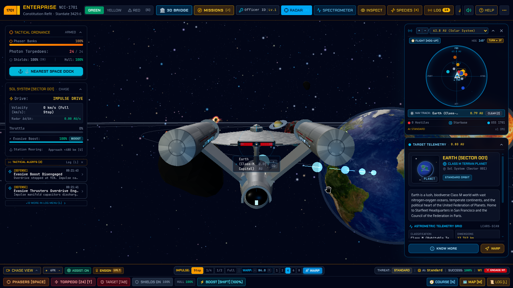
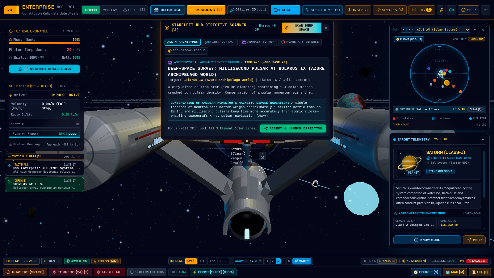
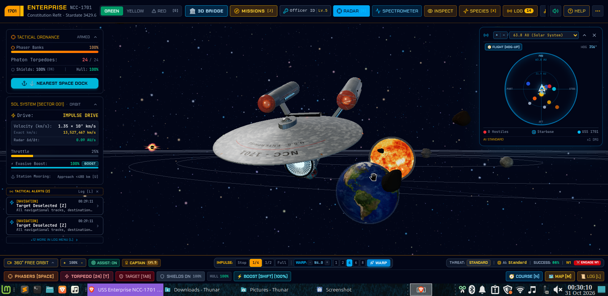
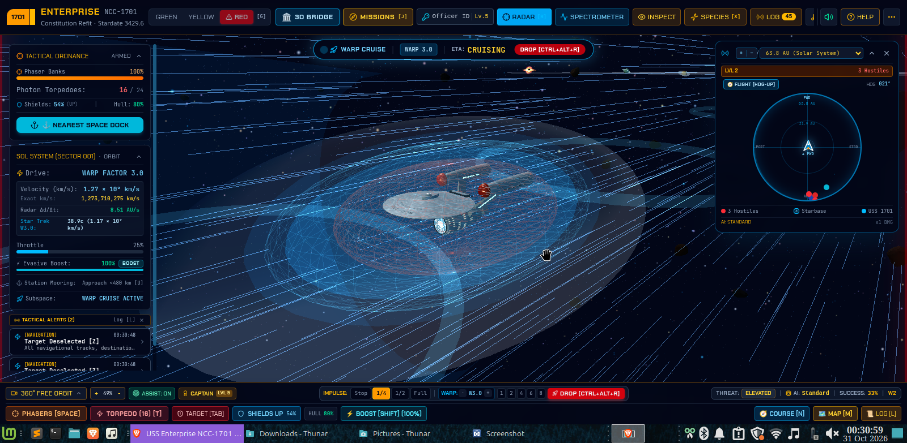
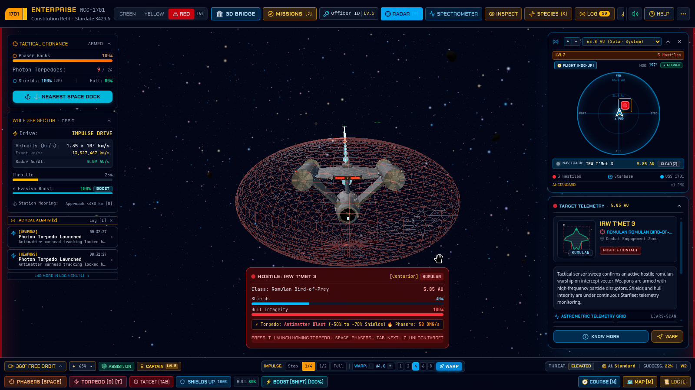
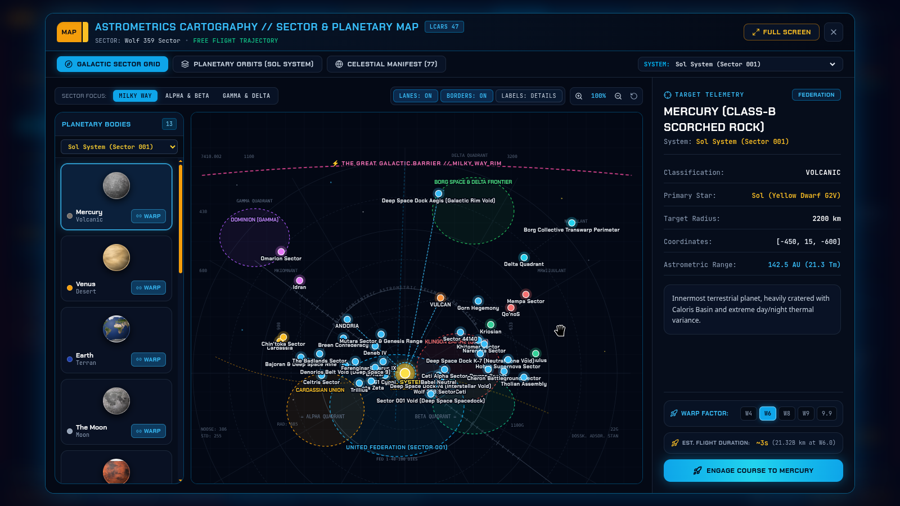

<div align="center">

# 🖖 USS ENTERPRISE (NCC-1701)
### 3D Astrometrics, Bridge Command & Deep-Space Astrophysics Simulation

[-3178C6?style=for-the-badge&logo=typescript&logoColor=white)](https://www.typescriptlang.org/)
[](https://react.dev/)
[-000000?style=for-the-badge&logo=threedotjs&logoColor=white)](https://threejs.org/)
[](https://tailwindcss.com/)
[](https://vitejs.dev/)
[](https://developer.mozilla.org/en-US/docs/Web/API/Web_Audio_API)

**STARFLEET COMMAND // SCIENCE EXHIBITION DOSSIER — REGISTRY: USS ENTERPRISE (NCC-1701)**  
*“To explore strange new worlds; to seek out new life and new civilizations; to boldly go where no one has gone before.”*

[🌌 Overview](#-1-the-vision-of-star-trek--sixty-years-of-scientific-legacy) •
[⚡ Quick Start (NPM)](#-2-getting-started--installation-npm) •
[📸 Screenshots](#-3-visual-tour--interface-gallery) •
[⚛️ Warp & Astrophysics](#-4-theoretical-physics-the-alcubierre-metric--astrophysics-engine) •
[🛠️ Architecture](#-5-software-architecture--60-fps-procedural-engine) •
[🎮 Flight Manual](#-6-flight-controls-keyboard-shortcuts--bridge-operations) •
[🗺️ Star Map](#-7-galactic-cartography-30-star-systems--kerr-singularity) •
[🔬 Missions & Labs](#-8-starfleet-missions-science-workstations--officer-profiles)

</div>

---

## 🌌 1. The Vision of *Star Trek* & Sixty Years of Scientific Legacy

### 1.1 Philosophy of the United Federation of Planets
Created by **Gene Roddenberry** and debuting in September 1966, *Star Trek* envisioned a future a few centuries from now where humanity did not destroy itself. Instead, humankind transcended war, poverty, and systemic prejudice on Earth, mastered relativistic interstellar spaceflight, and united with peaceful extraterrestrial civilizations to form the **United Federation of Planets**.

At the heart of this philosophy is **Starfleet**—an organization dedicated not to galactic conquest, but to scientific curiosity, humanitarian aid, and peaceful diplomacy governed by the **Prime Directive** (*Starfleet General Order 1*), which strictly prohibits interfering in the natural internal evolution of developing civilizations. Flagships like the *Constitution*-class heavy cruiser **USS Enterprise (NCC-1701)** (288.6m length, 21 decks, 430 crew) operate as self-sustaining mobile research laboratories equipped with deep-space spectroscopic sensors, astrophysical workstations, and defensive shields designed to chart cosmic anomalies and initiate peaceful First Contact.

### 1.2 The Symbiotic Legacy of *Star Trek* and NASA
For over sixty years, *Star Trek* and the **National Aeronautics and Space Administration (NASA)** have shared a uniquely reciprocal history in which science fiction directly catalyzed science fact:
* **Space Shuttle *Enterprise* (OV-101):** In 1976, following a nationwide campaign of nearly 100,000 letters from *Star Trek* fans, President Gerald Ford directed NASA to rechristen its first Space Shuttle test orbiter from *Constitution* to ***Enterprise***. Creator Gene Roddenberry and the original bridge cast stood alongside NASA leadership as OV-101 rolled out of the Palmdale hangar to Alexander Courage's iconic theme.
* **Transforming the Astronaut Corps:** In 1977, actress **Nichelle Nichols** (Lt. Nyota Uhura)—who had remained on the show after civil rights leader Dr. Martin Luther King Jr. personally urged her not to resign—partnered with NASA through *Women in Motion, Inc.* to lead a historic nationwide recruitment drive for **NASA Astronaut Group 8**. Her campaign surged applications from fewer than 1,500 to over 8,000, directly recruiting pioneering astronauts **Dr. Sally Ride** (first American woman in space), **Col. Guion Bluford** (first African-American in space), **Dr. Ronald McNair**, **Dr. Judith Resnik**, **Dr. Kathryn Sullivan**, **Col. Frederick Gregory**, and **Col. Ellison Onizuka**, and inspiring **Dr. Mae Jemison** (first Black woman in space aboard STS-47, who opened every orbital shift with *"Hailing frequencies open"* and later led DARPA/NASA's *100 Year Starship* initiative).
* **From Starfleet Props to Real-World Engineering:**
  * **Handheld Communicators (1966)** directly inspired Motorola engineer Martin Cooper to invent the first handheld mobile phone in 1973.
  * **PADDs (Personal Access Display Devices)** prefigured modern capacitive touchscreen tablets decades before their commercial realization.
  * **Tricorders & Remote Spectroscopy** inspired both Google Earth's mapping architecture and the XPRIZE Foundation's handheld non-invasive medical diagnostic competitions.
  * **Ion Propulsion:** Dr. Marc Rayman (Chief Engineer and Mission Director of NASA's *Deep Space 1* and *Dawn* missions to Vesta and Ceres) explicitly credited the *Star Trek* episode *"Spock's Brain"* with introducing him to ion propulsion physics.
  * **Exoplanet Astrophysics:** When *Star Trek* debuted in 1966, not a single exoplanet had ever been detected. Today, NASA's *Kepler*, *TESS*, and *James Webb Space Telescope (JWST)* have confirmed over 5,700 exoplanets—including real stellar counterparts to *Star Trek* worlds such as **40 Eridani A** (Vulcan's triple-star home system, 16.3 light-years away), **Wolf 359** (a real ultra-cool red dwarf 7.86 light-years away in Leo), and circumbinary worlds like **Kepler-16b** mirroring Risa.

### 1.3 What Is This Project?
The **USS Enterprise (NCC-1701) 3D Simulation** turns intimidating textbook physics and astronomical formulas into an interactive, real-time **60 FPS WebGL spaceflight, bridge-command, and astrophysical laboratory** running directly in the browser. Unlike static planetariums or pre-rendered videos, this software constructs a living three-dimensional galaxy using **100% procedural 3D geometry** (zero heavy external `.gltf`/`.obj` downloads), physically based rendering (PBR), custom GLSL spacetime shaders, and real 2K NASA planetary surface maps.

Users can seamlessly transition between an **External 3D Chase/Orbit Camera** and a **First-Person 3D Bridge Interior** across **5 interactive crew stations**, pilot the *Enterprise* across **30 canonical Star Systems** in all four quadrants, conduct real-world **Fraunhofer/Balmer spectroscopy**, **Magnetohydrodynamic (MHD) planetary core rescues**, and **SETI Cosmic Water Hole First Contact diplomacy**, or engage in multi-wave tactical defense against Klingon, Romulan, Cardassian, Gorn, Tholian, and Borg vessels.

---

## ⚡ 2. Getting Started & Installation (NPM)

Follow these steps to clone the repository, install dependencies via `npm`, and launch the LCARS simulation engine locally.

### Prerequisites
* **Node.js** `v18.0.0+` (Recommended: `v20 LTS` or `v22+`)
* **npm** `v9.0.0+` (included with Node.js)
* A modern desktop browser with **WebGL 2.0** and **Web Audio API** support (Chrome, Edge, Brave, or Firefox)

### Step-by-Step Installation

1. **Clone the Repository**
   ```bash
   git clone https://github.com/Shivam180709/Star-Trek-3D-Simulation.git
   ```

2. **Navigate into the Project Directory**
   ```bash
   cd Star-Trek-3D-Simulation
   ```

3. **Install Dependencies via NPM**
   ```bash
   npm install
   ```

4. **Start the Development Server (Vite ES-Module Bundler)**
   ```bash
   npm run dev
   ```
   > Once initialized, open your browser and navigate to **`http://localhost:3000`** (or the local port displayed in your terminal). The *USS Enterprise* will initialize in the **Sol System (Sector 001)** near Earth at **0% Throttle (Full Stop)** so you can inspect the ship, open the 3D Bridge, or plot your first warp course.

5. **Build & Preview for Production / Science Exhibition Kiosks**
   ```bash
   # Compile TypeScript and bundle production assets into /dist
   npm run build

   # Preview the optimized production build locally
   npm run preview
   ```

---

## 📸 3. Visual Tour & Interface Gallery

All official simulation captures are stored in the repository under [`/public/Screenshots`](https://github.com/Shivam180709/Star-Trek-3D-Simulation/tree/main/public/Screenshots).

> 💡 **Note on Screenshot File Naming:** GitHub automatically renders any relative image path pointing to `./public/Screenshots/<filename>.png` right inside this README. Below is the visual showcase connected to your [`/public/Screenshots`](https://github.com/Shivam180709/Star-Trek-3D-Simulation/tree/main/public/Screenshots) directory (if any screenshot in your folder uses a custom filename, simply match the filename in the path below):

<div align="center">

### 🛸 External Flight Telemetry, Sol System & Warp Drive
| **USS Enterprise in Orbit (LCARS Flight HUD)** | **Relativistic Warp Drive & Subspace Bubble** |
| :---: | :---: |
|  |  |
| *Calibrated AU radar, scientific/integer velocity ($\text{km/s}$), and 2K NASA planetary textures.* | *Custom GLSL Alcubierre warp distortion shader and procedural subspace particle streaks.* |

### 🪑 Interactive 3D Bridge Interior & Galactic Cartography
| **3D Multi-Tiered Bridge Interior (Stations 1–5)** | **Astrometrics Star Map (30 Solar Systems)** |
| :---: | :---: |
|  |  |
| *12-sided radial bridge with live HTML5 `CanvasTexture` oscilloscopes and 8x viewscreen zoom.* | *Alpha, Beta, Gamma & Delta Quadrant cartography with 1-click collision-safe warp plotting.* |

### 🔬 Astrophysical Laboratories, Tactical Combat & 360° Subsystem Inspection
| **Planetary Spectroscopy & Science Workstation** | **Tactical Combat, Spacedock & 360° Inspection** |
| :---: | :---: |
|  |  |
| *Balmer $\text{H}\alpha$ / $[\text{O III}]$ grating spectrometer, atmospheric composition, and MHD rescue.* | *Dual saucer phaser arrays, homing photon torpedoes, and 14 inspectable 3D hull subsystems.* |

*(👉 **[Click here to browse the complete high-resolution gallery in `/public/Screenshots`](https://github.com/Shivam180709/Star-Trek-3D-Simulation/tree/main/public/Screenshots)**)*

</div>

---

## ⚛️ 4. Theoretical Physics: The Alcubierre Metric & Astrophysics Engine

### 4.1 Matter-Antimatter Annihilation & Relativistic Power
Following the physical evaluation framework established by NASA Goddard Space Flight Center astrophysicist **Dr. David Allen Batchelor** (*"The Science of Star Trek"*), the *Enterprise* warp core generates power by annihilating deuterium (normal matter) with antideuterium (antimatter) suspended in magnetic Penning traps. Unlike nuclear fission or fusion (which convert $<1\%$ of rest mass into energy), matter-antimatter annihilation converts $100\%$ of the reactants' rest mass ($m$) directly into energy ($E$):

$$E = mc^2 \quad \left(c \approx 2.99792458 \times 10^8\ \text{m/s}\right)$$

At relativistic sub-light velocities powered by deuterium fusion **Impulse Engines**, the forward **Parabolic Navigational Deflector Dish** projects directional force fields to sweep stray hydrogen atoms and micrometeoroids out of the flight path, preventing catastrophic relativistic kinetic impacts governed by:

$$E_k = (\gamma - 1)mc^2, \quad \text{where} \quad \gamma = \frac{1}{\sqrt{1 - v^2/c^2}}$$

### 4.2 General Relativity & The Alcubierre Warp Drive Metric (1994)
Under Einstein's Special Relativity, no physical object can accelerate *locally* through flat space faster than the speed of light ($c$). However, in May 1994, theoretical physicist **Miguel Alcubierre** published his seminal paper *"The warp drive: hyper-fast travel within general relativity"* (*Classical and Quantum Gravity*, 11-5, L73–L77; `arXiv:gr-qc/0009013`), proving that within Einstein's General Relativity:

$$G_{\mu\nu} + \Lambda g_{\mu\nu} = \frac{8\pi G}{c^4} T_{\mu\nu}$$

spacetime itself can be locally distorted without introducing wormholes. Using the $3+1$ Arnowitt-Deser-Misner (ADM) formalism:

$$ds^2 = -d\tau^2 = g_{\alpha\beta}dx^\alpha dx^\beta = -\left(\alpha^2 - \beta_i\beta^i\right)dt^2 + 2\beta_i dx^i dt + \gamma_{ij}dx^i dx^j$$

Alcubierre formulated a spacetime metric for a starship moving along the $x$-axis with trajectory $x_s(t)$ and coordinate velocity $v_s(t) = dx_s(t)/dt$ (in geometric units $G = c = 1$, where $\alpha = 1$, $\beta^x = -v_s(t)f(r_s(t))$, $\beta^y = \beta^z = 0$, and $\gamma_{ij} = \delta_{ij}$):

$$ds^2 = -dt^2 + \left(dx - v_s(t)f(r_s)dt\right)^2 + dy^2 + dz^2$$

where $r_s(t) = \left[(x - x_s(t))^2 + y^2 + z^2\right]^{1/2}$ is the radial distance from the ship's center and $f(r_s)$ is a smooth "top-hat" shaping function parameterized by warp bubble radius $R > 0$ and wall thickness $\sigma > 0$:

$$f(r_s) = \frac{\tanh\left(\sigma(r_s + R)\right) - \tanh\left(\sigma(r_s - R)\right)}{2\tanh(\sigma R)}$$

From this metric, three foundational physical properties emerge—all directly modeled in `subspaceDistortionShader.ts` and `scaleFormatters.ts`:
1. **Contraction Ahead & Expansion Behind:** The volume expansion scalar $\theta = -\alpha\ \text{Tr}(K)$ of normal volume elements is:
   $$\theta = v_s \frac{x - x_s}{r_s} \frac{df}{dr_s}$$
   Because $df/dr_s < 0$ at the bubble wall ($r_s \simeq R$), spacetime **expands behind the ship** ($\theta > 0$ for $x < x_s$) and **contracts ahead of the ship** ($\theta < 0$ for $x > x_s$).
2. **Free-Fall Geodesic & Zero Time Dilation:** Inside the flat center of the warp bubble ($r_s = 0 \implies f(0) = 1$), the line element reduces to:
   $$d\tau = dt$$
   The starship moves on a timelike geodesic in free fall with **zero proper acceleration** (the crew experiences zero crushing G-forces during instant warp jumps) and **zero relativistic time dilation** relative to stationary clocks on Earth.
3. **Exotic Matter Requirement:** Contracting the Einstein tensor with the Eulerian four-velocity yields a negative energy density everywhere within the bubble wall:
   $$\rho_E = T_{\alpha\beta}n^\alpha n^\beta = \frac{1}{8\pi}G_{00} = -\frac{1}{8\pi}\frac{v_s^2(y^2 + z^2)}{4r_s^2}\left(\frac{df}{dr_s}\right)^2 < 0$$
   demonstrating why generating a warp bubble requires quantum negative energy densities (analogous to the Casimir effect).

### 4.3 Astronomical Scale Calibration & Exact Kinematic Synchronization
To render entire solar systems from the primary star out to distant singularities in WebGL without floating-point Z-fighting while maintaining strict mathematical consistency between the **Flight Telemetry HUD** and **Tactical Radar**, the engine enforces a linear calibration in `src/utils/scaleFormatters.ts`:

* **$1\ \text{Astronomical Unit (AU)} = 149,597,870.7\ \text{km} = 235\ \text{Scene Units}$**
* **$1\ \text{Scene Unit} = \frac{149,597,870.7\ \text{km}}{235} \approx 636,586.6838\ \text{km}$**
* **Why Radar $\Delta d/\Delta t = \text{Velocity}$:** At every frame, both the radar distance countdown and the displayed speed derive from the exact same 3D velocity vector $\mathbf{v}_{\text{scene}}$:
  $$\frac{d(D_{\text{AU}})}{dt} = \frac{\|\mathbf{v}_{\text{scene}}\|}{235}\ \text{AU/s} \Longleftrightarrow \text{Velocity (km/s)} = \|\mathbf{v}_{\text{scene}}\| \times 636,586.6838\ \text{km/s}$$
  Both scientific notation (e.g., $5.41 \times 10^7\ \text{km/s}$) and exact integer notation ($54,109,868\ \text{km/s}$) update simultaneously in real time.

### 4.4 Canonical Warp Factor Scales (Okuda TNG Scale vs. TOS Cubic Scale)
The simulator implements both the **Modified Michael Okuda Scale** ($v = w^{10/3}c$ for $1 \le w \le 9$, rising asymptotically toward infinity at **Eugene's Limit**, Warp $10 = \infty$) and the **Original Series Cubic Scale** ($v = w^3c$):

| Warp Factor | TNG Okuda Scale ($v = w^{10/3}c$) | Exact Velocity ($\text{km/s}$) | TOS Cubic Scale ($v = w^3c$) | Operational Benchmark |
| :--- | :--- | :--- | :--- | :--- |
| **Warp 1.0** | $1.00\ c$ | $2.998 \times 10^5\ \text{km/s}$ ($299,792\ \text{km/s}$) | $1.00\ c$ | Zefram Cochrane's *Phoenix* (2063) |
| **Warp 2.0 / 3.0** | $10.08\ c$ / $38.94\ c$ | $3.02 \times 10^6$ / $1.17 \times 10^7\ \text{km/s}$ | $8.00\ c$ / $27.00\ c$ | Early NX-Class Testbeds |
| **Warp 4.0 / 5.0** | $101.59\ c$ / $213.75\ c$ | $3.05 \times 10^7$ / $6.41 \times 10^7\ \text{km/s}$ | $64.00\ c$ / $125.00\ c$ | *Enterprise* NX-01 Max Warp |
| **Warp 6.0 / 7.0** | $392.50\ c$ / $656.14\ c$ | $1.18 \times 10^8$ / $1.97 \times 10^8\ \text{km/s}$ | $216.00\ c$ / $343.00\ c$ | NCC-1701 Standard Cruise |
| **Warp 8.0 / 9.0** | $1,024.00\ c$ / $1,516.38\ c$ | $3.07 \times 10^8$ / $4.55 \times 10^8\ \text{km/s}$ | $512.00\ c$ / $729.00\ c$ | NCC-1701 Structural Limit ($V_{\text{NE}}$) |
| **Warp 9.2 / 9.6 / 9.9** | $1,649\ c$ / $1,909\ c$ / $3,053\ c$ | Up to $9.15 \times 10^8\ \text{km/s}$ | Approaches Asymptote | High-Warp Interceptor Ceiling |

---

## 🛠️ 5. Software Architecture & 60 FPS Procedural Engine

### 5.1 Engineering Stack
| Layer / Technology | Version / Tool | Engineering Role in the USS Enterprise Simulator |
| :--- | :--- | :--- |
| **TypeScript** | `v7.0` (`ESNext`) | 100% strict static typing for 3D vectors, quaternions, `ShipState` telemetry, 30 solar system catalogs, and grading logic. |
| **Three.js (WebGL 2.0)** | `v0.186.1` | Real-time 60 FPS scene graph, PBR materials, procedural starship/bridge/planet meshes, 3D raycasting, and particle systems. |
| **GLSL Shaders** | Custom Vertex/Fragment | Per-vertex & per-pixel GPU shaders (`subspaceDistortionShader.ts`) for Alcubierre warp bubbles, Fresnel glow, and Kerr lensing. |
| **React 19** | `v19.0.1` | Declarative LCARS HUD overlays, spectroscopy & cartography modal laboratories, and reactive controls via `useState`/`useRef`/`useMemo`. |
| **Tailwind CSS** | `v4.3.3` | High-contrast LCARS telemetry grids, glassmorphism HUD frames (`backdrop-blur`), and hardware-accelerated animations. |
| **SAM-JS & Web Audio** | `v0.3.1` + Native API | Phoneme formant speech synthesis (`sam-js`) + `speechSynthesis` for the Duotronic Computer Voice, plus oscillator Web Audio SFX. |
| **Vite & Lucide React** | `v8.3` | Instant ES-module bundling on Port 3000 alongside crisp vector iconography for tactical reticles, radar sweeps, and spectrometers. |

### 5.2 Key Architectural Innovations
1. **Zero External 3D Model Dependency (`shipModel.ts` & `bridgeInterior.ts`):** Every 3D structure—including the *USS Enterprise* exterior (Saucer Section, Upper/Lower Sensor Domes, lit perimeter windows, Engineering Secondary Hull, multi-ring glowing Copper/Cyan Parabolic Deflector Dish, interconnecting Neck/Pylons, Twin Warp Nacelles with animated Bussard Ramscoops, and **14 inspectable 3D subsystem nodes**) and the **12-sided radial 3D Bridge Interior** (sunken command pit, `#8a95a5` metallic bulkheads, `#d9532f` segmented safety railings, Turbolift Alcove, articulated crew mannequins in Command Gold, Science Blue, and Operations Red uniforms, and live offscreen HTML5 `<canvas>` monitors mapped via `THREE.CanvasTexture`)—is constructed procedurally in memory. It loads instantaneously even on restricted exhibition Wi-Fi.
2. **Decoupled 60 FPS WebGL ↔ React 19 State Bridge (`simulationEngine.ts`):** Triggering React component re-renders 60 times per second on every `requestAnimationFrame` tick causes severe UI frame drops. The engine solves this via a two-tier decoupled bridge:
   ```text
   [ Three.js WebGL Loop (60+ FPS) ] ──(Throttled Telemetry Callback)──> [ React 19 LCARS HUD ]
     • Physics, Quaternions & Slerp                                        • Flight & Target Telemetry
     • Phasers, Torpedoes & Shaders                                        • 600ms Celestial Distance Sort
     • Live CanvasTexture Monitors                                         • Spectroscopy & Star Map Modals
   ```
3. **Collision Avoidance & Safe Standoff Vector Math:** When plotting an automated warp course, `calculateSafeCoordinates()` evaluates the Euclidean distance against every celestial body's physical and ring radius:
   $$\text{SafeRadius} = \max\left(R_{\text{planet}} \times 2.5 + 140,\ R_{\text{ring\_outer}} + 140,\ 220\right)$$
   automatically projecting the normalized approach vector $(\mathbf{p}_{\text{ship}} - \mathbf{p}_{\text{body}})/\|\mathbf{p}_{\text{ship}} - \mathbf{p}_{\text{body}}\|$ so the *Enterprise* drops out of warp in a clean orbital standoff outside planetary rings and atmospheres.
4. **100% Procedural Web Audio & Duotronic Computer Voice (`soundEffects.ts` & `computerVoice.ts`):** Phaser sizzles, photon torpedo bursts, warp core hums, Red Alert klaxons, and LCARS chirps are synthesized mathematically in real time using native `AudioContext` sawtooth, sine, square, and triangle oscillators, biquad filters, and gain envelopes.

### 5.3 Codebase Directory Map
```text
Star-Trek-3D-Simulation/
├── public/
│   ├── assets/planets/                 # Real 2K equirectangular NASA planetary & ring surface maps
│   └── Screenshots/                    # High-resolution simulation interface & gameplay captures
├── src/
│   ├── three/                          # 60 FPS Three.js WebGL Procedural Engine
│   │   ├── simulationEngine.ts         # Core animation loop, physics, raycasting & state bridge
│   │   ├── shipModel.ts                # Procedural USS Enterprise (NCC-1701) & 14 subsystem nodes
│   │   ├── bridgeInterior.ts           # 3D radial bridge, 5 crew stations, mannequins & CanvasTextures
│   │   ├── solarSystems.ts             # 30 canonical star systems, 2K NASA & procedural exoplanets
│   │   ├── spaceScene.ts               # Starfield, lighting & deep-space environment
│   │   ├── starbaseModels.ts           # Deep-Space Spacedocks, DS9 & autonomous 3D repair drones
│   │   ├── enemyShips.ts               # Klingon, Romulan, Cardassian, Gorn, Tholian & Borg vessels
│   │   ├── warpEffect.ts               # Warp entry/exit stretching & flash transitions
│   │   ├── subspaceDistortionShader.ts # Custom GLSL Alcubierre warp bubble & Kerr lensing shaders
│   │   ├── subspaceParticleStreaks.ts  # Relativistic starlight streak emitter
│   │   ├── particleExplosion.ts        # Volumetric torpedo impact & ship destruction particles
│   │   └── navPathGuide.ts             # 3D orbital & warp trajectory vector guide
│   ├── components/                     # React 19 LCARS Heads-Up Displays & Science Modals
│   │   ├── LCARSHeader.tsx             # Top command bar, Alert status & 6-Digit Officer Profile badge
│   │   ├── FlightHUD.tsx               # Left velocity/AU telemetry & Right target/wave status
│   │   ├── BridgeCommandHUD.tsx        # Station 1–5 switcher & specialized bottom bridge decks
│   │   ├── TacticalRadar.tsx           # Polar AU radar sweep (Short/Med/Long rings)
│   │   ├── LCARSControls.tsx           # Bottom flight, warp factor & tactical ordnance console
│   │   ├── StarSystemMapModal.tsx      # Full-screen Galaxy Quadrant & System Orbital Cartography
│   │   ├── PlanetaryScannerModal.tsx   # Multi-band spectroscopy & atmospheric composition lab
│   │   ├── ShipInspectionModal.tsx     # 360° interactive camera orbit of 14 ship subsystems
│   │   ├── SpeciesDatabaseModal.tsx    # Exobiology encyclopedia of alien civilizations
│   │   └── ...                         # Voice settings, combat logs, dossiers & help modals
│   ├── audio/                          # Web Audio API Synthesizer & Formant Speech
│   │   ├── soundEffects.ts             # Procedural oscillators for phasers, torpedoes & alerts
│   │   ├── computerVoice.ts            # SAM-JS formant + Web Speech Duotronic Computer Voice
│   │   └── battleThemeManager.ts       # Dynamic orchestral combat soundtrack cueing
│   ├── data/                           # Astrophysical, Mission & Canon Databases
│   │   ├── starfleetMissionsData.ts    # Curated & procedural science/tactical missions
│   │   ├── celestialObjectDatabase.ts  # Star, planet, moon & singularity astrophysical catalog
│   │   ├── planetaryScienceData.ts     # Spectral lines, magnetic fields & atmospheric gases
│   │   └── speciesDatabase.ts          # Civilization lore & diplomatic profiles
│   ├── types/
│   │   └── simulation.ts               # Strict TypeScript interfaces for ShipState & SolarSystems
│   ├── utils/
│   │   └── scaleFormatters.ts          # Exact AU, km/s, Okuda/Cubic Warp & standoff math
│   ├── App.tsx                         # Main application orchestrator
│   └── main.tsx                        # React DOM entry point
├── index.html
├── package.json
└── vite.config.ts
```

---

## 🎮 6. Flight Controls, Keyboard Shortcuts & Bridge Operations

### 6.1 Complete Keyboard & Mouse Control Reference

| Category | Key / Input | Action / Function |
| :--- | :--- | :--- |
| **3D Attitude & Steering** | `W` / `↑` or `S` / `↓` | Pitch Nose Down / Pitch Nose Up |
| | `A` / `←` or `D` / `→` | Yaw Turn Port (Left) / Starboard (Right) |
| | `Q` / `E` | Roll Bank Counter-Clockwise (Port) / Clockwise (Starboard) |
| | `Mouse Click + Drag` | 3D Camera Orbit / Bridge First-Person Look (`phi` clamped to prevent gimbal lock) |
| | `Mouse Scroll` / `+` / `-` | Smooth Camera Zoom (External & Bridge POV) + Viewscreen Optical Zoom (`1x`–`8x`) |
| **Propulsion & Warp** | `Ctrl + Alt + 1..9` | Immediately Engage **Warp Factor 1 to 9** |
| | `Ctrl + Alt + R` | **Abort Warp / Drop to Impulse** (Immediately restores manual `WASD` helm control) |
| | `Shift` | Engage Evasive Thruster Boost |
| | `Z` | Deselect Target / Cancel Automated Course Routing |
| **Tactical & Defense** | `Spacebar` *(Hold)* | Fire Dual Dorsal/Ventral Saucer Phaser Arrays |
| | `T` | Launch Homing Photon Torpedo (32 Torpedo Magazine) |
| | `Tab` | Cycle Lock to Next Hostile Vessel |
| | `G` *(Single / Double)* | Toggle **Condition Yellow** / **Condition Red** (Battle Stations) |
| | `U` | Dock / Undock at Nearest Starfleet Spacedock ($\le 650$ units; deploys 3D Repair Drones) |
| **Bridge & Consoles** | `C` | Cycle Camera Perspectives (Chase, Tactical, Cinematic, Orbit, **3D Bridge POV**) |
| | `1` / `2` / `3` / `4` / `5` | Smoothly `lerp`/`slerp` between the **5 First-Person Bridge Crew Stations** |
| | `M` / `N` | Open Full-Screen **Astrometrics Star Map** (`M`) / Quick Course Plotter (`N`) |
| | `J` / `X` | Open **Starfleet Mission Briefing** (`J`) / **Exobiology Species Database** (`X`) |
| | `R` / `L` | Toggle **Tactical Radar Overlay** (`R`) / **Tactical Combat Log** (`L`) |

### 6.2 The 5 Interactive 3D Bridge Crew Stations (`BridgeCommandHUD.tsx`)
Pressing `1`–`5` inside the 3D Bridge smoothly interpolates your eye position (`Vector3.lerp`) and look orientation (`Quaternion.slerp`) to the target station while automatically hiding that seat's 3D officer mannequin for an unobstructed view of the Panoramic Main Viewscreen:
* **`[1]` Captain's Chair:** Center command pedestal with interactive armrest controls, Condition Green/Yellow/Red alert selectors, fleet reinforcement summons, and `1.0x`–`8.0x` Optical Viewscreen Zoom.
* **`[2]` Helm & Navigation Island:** Forward T-shaped dual console featuring 3D attitude heading/pitch readouts, Impulse presets (`1/4`, `1/2`, `3/4`, `FULL`), Warp Factor slider (`1.0`–`9.9`), and Automated Course Plotter.
* **`[3]` Tactical & Weapons Station:** Features an embedded **Live Target Pinpoint Viewscreen Monitor** mirroring the locked hostile ship with targeting reticles, real-time Enemy Hull/Shield bars, `[<< PREV]` / `[NEXT >>]` target cycling, Dual Phaser trigger, Photon Torpedo launcher, and Shield Harmonic tuner ($\text{MHz}$).
* **`[4]` Science & Astrometrics Station:** Grating Spectrometer wavelength tuner ($100\text{–}900\ \text{nm}$), Main Deflector Particle Beam emitter, Planetary Spectroscopy Lab launcher, and Celestial Dossier scanner.
* **`[5]` Communications & Engineering Station:** Subspace Transceiver carrier frequency tuner ($\text{MHz}$), First Contact diplomatic hailing link, and Spacedock clamps / Autonomous Orbital Repair Drone deployment controls.

---

## 🗺️ 7. Galactic Cartography: 30 Star Systems & Kerr Singularity

Pressing `M` opens the **Astrometrics Cartography Console**, mapping **30 canonical Star Systems** across the **Alpha, Beta, Gamma, and Delta Quadrants**:

| Sys # | Sector / Star System | Quadrant | Primary Stars, Planets, Moons, Anomalies & Spacedocks |
| :---: | :--- | :--- | :--- |
| **01** | **Sol System (Sector 001)** | Alpha (UFP Core) | Sun (G2V), Mercury, Venus, Earth, Luna, Mars, Jupiter, Europa, Saturn, Titan, Uranus, Neptune, Pluto & Charon, **Sol Singularity (Kerr Black Hole, 60.5 AU)**. |
| **02–05** | **Vulcan, Andoria, Tellar, Betazed** | Alpha & Beta | 40 Eridani A, Vulcan (Class-M), T'Khut; Procyon (F5), Andoria (Class-P Ice Moon); 61 Cygni Binary, Tellar Prime; Beta Zeta, Betazed. |
| **06–10** | **Trill, Risa, Wolf 359, Docks 1 & 74** | Alpha & Beta | Trillius Prime & Trill; Epsilon Ceti B & Risa; Wolf 359 Red Dwarf, Memorial Buoy & *USS Saratoga* Hulk; Spacedock One & Dock 74. |
| **11–15** | **Deneb IV, Babel, Bolarus, Benzar, Ceti Alpha** | Alpha Quadrant | Deneb Kaitos & Farpoint; Babel Planetoid; Bolarus IX; Benzar; Ceti Alpha Red Dwarf, Ceti Alpha V & *SS Botany Bay* Relic. |
| **16–20** | **Qo'noS, Khitomer, Narendra, Mempa, Krios** | Beta (Klingon) | Klingon Prime, Qo'noS, Praxis Remnant, Rura Penthe, Boreth & **Qo'noS White Hole**; Khitomer; Narendra III; Mempa; Krios Prime. |
| **21–25** | **Romulus, K-7, Hobus, Devron, Cheron** | Beta (Romulan) | Romulan Binary Sun, Romulus & Remus; Deep Space Station K-7; Hobus Supernova Giant; Devron Anti-Time Rift; Cheron Minefield. |
| **26–29** | **Cardassia, Chin'toka, Celtris, Bajor (DS9)** | Alpha (Cardassian) | Cardassia Prime & Shipyards; Chin'toka Platforms; Celtris III; Bajor, **Bajoran Wormhole (Celestial Temple)** & **Deep Space 9**. |
| **30+** | **Frontier, Gamma & Delta Quadrants** | Alpha, Beta, Gamma, Delta | Badlands Plasma Nebula; Ferenginar; Breen; Mutara Nebula & Genesis Planet; Briar Patch; Gornar; Tholia; **Idran Gamma Wormhole**; **Omarion Founders' Homeworld**; **Caretaker Array (Ocampa V)**; **Borg Unicomplex & Transwarp Hub 01**; **Dock Aegis**. |

### 🕳️ Relativistic Kerr Black Hole (Sol) $\rightarrow$ White Hole (Qo'noS) Transit
Positioned $21\ \text{AU}$ beyond Pluto at coordinates `[11335, 110, 8600]` ($\approx 60.5\ \text{AU}$ from the Sun so its gravity never perturbs planetary orbits), the **Sol Singularity** is a rotating **Kerr Black Hole** surrounded by a blazing relativistic accretion disk and gravitational lensing halo:

$$R_s = \frac{2GM}{c^2}, \qquad z_{\text{grav}} = \left(1 - \frac{R_s}{r}\right)^{-1/2} - 1$$

Approaching within $310\ \text{Scene Units}$ ($\approx 1.3\ \text{AU}$) intensifies spacetime frame-dragging. Crossing the event horizon triggers an **Einstein-Rosen Bridge (Wormhole)** transit sequence, catapulting the *Enterprise* across quadrants to emerge from the incandescent **Qo'noS White Hole** (`[79100, 2400, -90900]`) in the Klingon Empire!

---

## 🔬 8. Starfleet Missions, Science Workstations & Officer Profiles

Pressing `J` opens the **Starfleet Command Mission Briefing Console**, featuring curated story campaigns and an infinite **Procedural Mission Generator** across four scientific archetypes:

1. **📡 Archetype 1: First Contact & Xenolinguistics (Radio Astronomy & Game Theory)**
   * **Real Science Taught:** Tuning into the **SETI Cosmic Water Hole**—the quiet microwave band between the **Neutral Hydrogen ($\text{H I}$) $21\text{-cm}$ hyperfine spin-flip line ($1420.405\ \text{MHz}$)** and the **Hydroxyl ($\text{OH}$) radical maser line ($1612.231\ \text{MHz}$)** ($\text{H} + \text{OH} = \text{H}_2\text{O}$)—combined with mathematical **Game Theory** (*Nash Bargaining Equilibrium*, *Stag Hunt Cooperation*, *Credible Deterrence*, and *Verified Prisoner's Dilemma Mirroring*).
2. **🌈 Archetype 2: Astrophysical Anomaly Lab (Quantum Spectroscopy)**
   * **Real Science Taught:** Calibrating the **Grating Spectrometer** to real emission lines governed by the **Rydberg Formula**:
     $$\frac{1}{\lambda} = R_H \left(\frac{1}{n_1^2} - \frac{1}{n_2^2}\right) \quad \left(R_H \approx 1.097 \times 10^7\ \text{m}^{-1}\right)$$
     including **Balmer $\text{H}\alpha$ ($n = 3 \rightarrow 2,\ \lambda = 656.28\ \text{nm}$ ruby-red nebula emission)**, **Forbidden Doubly-Ionized Oxygen $[\text{O III}]$ ($\lambda = 500.7\ \text{nm}$ teal-green metastable transition occurring only in ultra-low-density nebulae)**, **Ionized Helium $\text{He II}$ ($468.6\ \text{nm}$)**, and **Iron K-Shell X-ray transitions ($185.0\ \text{nm}$)**, alongside Fermi shock acceleration in supernova remnants.
3. **🧲 Archetype 4: Planetary Magnetosphere & MHD Geodynamo Rescue**
   * **Real Science Taught:** Protecting planetary atmospheres from Coronal Mass Ejections (CMEs) and core dynamo collapse using **Magnetohydrodynamics (MHD)**:
     * **Lorentz Force Deflection:** $\mathbf{F} = q(\mathbf{E} + \mathbf{v} \times \mathbf{B})$
     * **Magnetopause Ram vs. Magnetic Pressure Balance:** $P_{\text{ram}} = \rho v^2 = \frac{B^2}{2\mu_0}$
     * **Magnetic Induction Equation:** $\frac{\partial \mathbf{B}}{\partial t} = \nabla \times (\mathbf{v} \times \mathbf{B}) + \eta \nabla^2 \mathbf{B}$
     * **Cyclotron Resonance & Escape Velocity:** $\omega_c = \frac{|q|B}{m}$ and $v_{\text{esc}} = \sqrt{\frac{2GM}{R}}$
4. **🛡️ Archetype 3: Planetary Defense, Adaptive AI & Starfleet Officer Progression**
   * Intercept multi-wave hostile squadrons scaled by a rolling **Adaptive AI Combat Rating** (5 tiers from *Standard* to *Legendary*).
   * Earn official **Starfleet Performance Grades (`S`, `A`, `B`, `C`, `D`)** and advance across **10 Canonical Starfleet Ranks**:
     `Ensign` $\rightarrow$ `Lieutenant JG` $\rightarrow$ `Lieutenant` $\rightarrow$ `Lt. Commander` $\rightarrow$ `Commander` $\rightarrow$ `Captain` $\rightarrow$ `Commodore` $\rightarrow$ `Rear Admiral` $\rightarrow$ `Vice Admiral` $\rightarrow$ `Fleet Admiral`.
   * **🪪 6-Digit Science Exhibition Officer PIN System:** Designed specifically for high-traffic exhibition booths, clicking the Officer Badge in the top LCARS bar generates a unique **6-Digit Officer PIN Code** (e.g., `482910`). Your rank, XP, and mission transcripts serialize locally under that PIN so another visitor can take a turn and you can restore your career anytime by entering your code.

---

## 📚 9. Scientific References & Primary Bibliography

1. **Alcubierre, Miguel (1994).** *"The warp drive: hyper-fast travel within general relativity."* Classical and Quantum Gravity, 11(5), L73–L77 (`arXiv:gr-qc/0009013v1`).
2. **Batchelor, David Allen (1993/2009).** *"The Science of Star Trek."* NASA Goddard Space Flight Center / SpaceNews.
3. **Uri, John (2019/2022).** *"50 Years of NASA and Star Trek Connections."* NASA History Division, Lyndon B. Johnson Space Center.
4. **Brennan, Pat & NASA Exoplanet Exploration Program.** *"Top 10 Star Trek Destinations Chosen by NASA Scientists"* & *"To Boldly Go: How Star Trek Inspired NASA's Planet Hunters."* NASA Jet Propulsion Laboratory / Caltech.
5. **Misner, C. W., Thorne, K. S., & Wheeler, J. A. (1973).** *Gravitation.* W. H. Freeman.

---

<div align="center">

### 🖖 *"Make It So — Engage!"*
Developed by **[Shivam180709](https://github.com/Shivam180709)** • [Star-Trek-3D-Simulation Repository](https://github.com/Shivam180709/Star-Trek-3D-Simulation)

</div>
